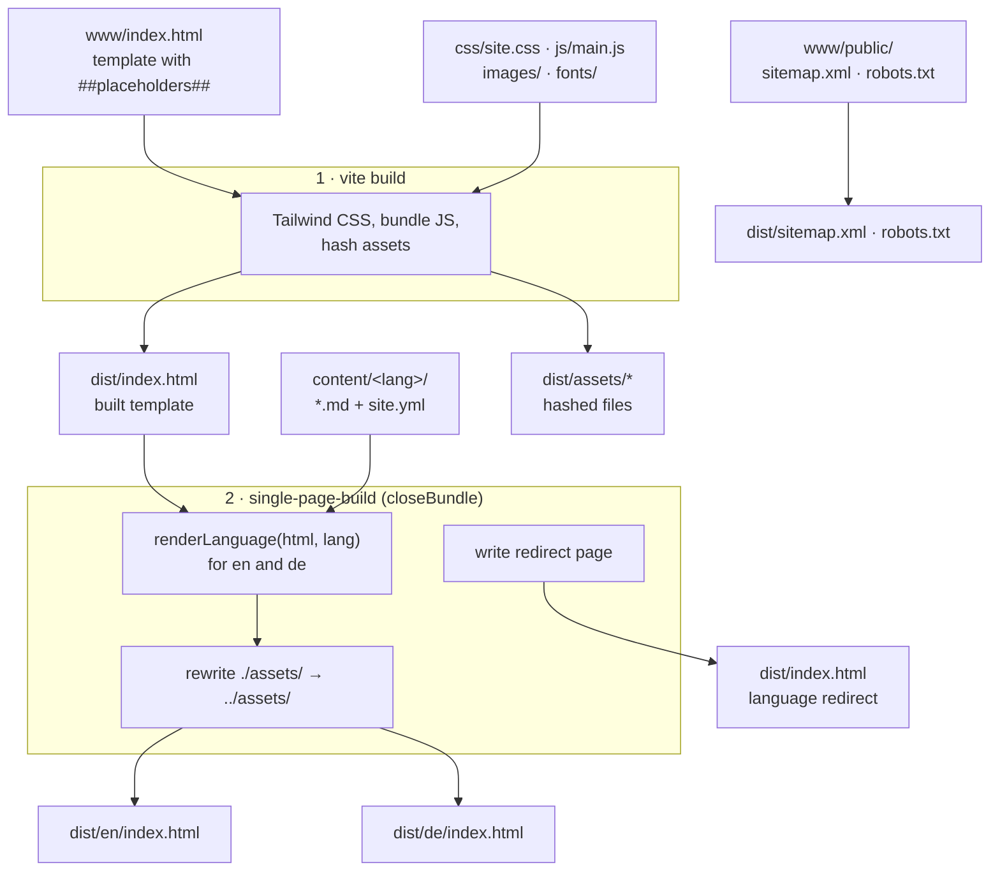
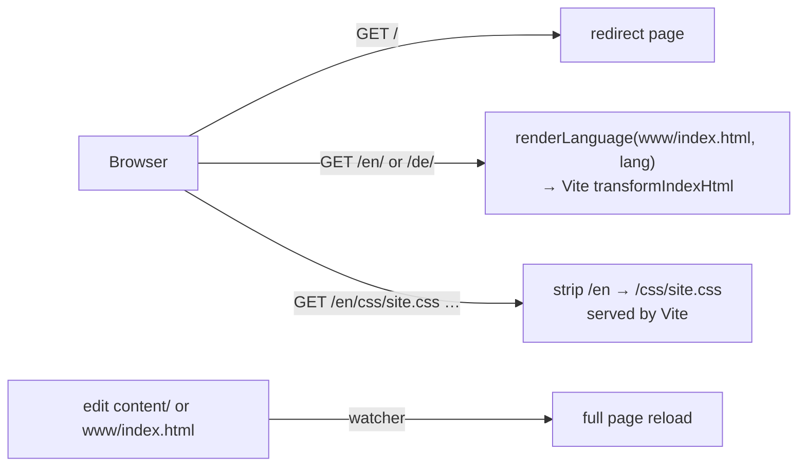
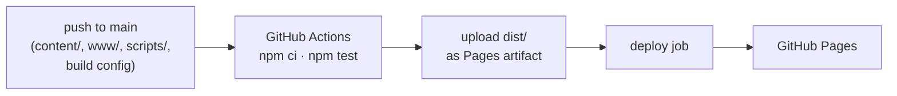

# Build

The site is one page per language, built from one template and one content folder per language.

| Input | Role |
|---|---|
| `www/index.html` | The single page template with `##placeholders##` |
| `content/en/`, `content/de/` | Text: Markdown blocks (`HERO.md`, `WELCOME.md`, …) and short strings in `site.yml` |
| `www/css/site.css` | Tailwind v4 entry point, fonts, theme, styles for rendered Markdown |
| `www/js/main.js` | Menu, active section, legal dialogs |
| `www/images/`, `www/fonts/` | Assets, hashed by Vite |
| `www/public/` | Copied as is (`sitemap.xml`, `robots.txt`, `cms.js`) |
| `www/public/cms.js` | The cmsfree browser editor, copied from the cmsfree repo (`dist/cms.js`). Do not edit it here |
| `scripts/build-content.mjs` | Renderer: fills the placeholders for one language |

## Production build

`npm run build` runs `vite build` with two steps: Vite builds the template once, then the `single-page-build` plugin in `vite.config.js` renders it per language.



1. **Vite** builds `www/index.html`: Tailwind generates the CSS, `main.js` is bundled, images and fonts get hashed names in `dist/assets/`. The placeholders pass through untouched. Because `base` is `'./'`, every asset URL is relative (`./assets/…`), so the site works on `unfolding.pt` and under `cawoodm.github.io/site-unfolding.pt/`.
2. **The plugin** reads the built `dist/index.html` and calls `renderLanguage()` once per language (`LANGUAGES` = `en`, `de`). Each result moves one folder down, so `./assets/` becomes `../assets/`, and is written to `dist/<lang>/index.html`.
3. **The plugin** then overwrites `dist/index.html` with the redirect page: German if the browser ranks German above English, otherwise English (without JS: English).

Output:

```
dist/
  index.html        language redirect
  en/index.html     English page (legal notice + privacy as dialogs)
  de/index.html     German page (Impressum + Datenschutz as dialogs)
  assets/…          shared CSS, JS, images, fonts
  sitemap.xml, robots.txt
```

Any error in the renderer is thrown inside the plugin and fails the build.

## Rendering a language

`renderLanguage(templateHtml, lang)` loads `content/<lang>/` and replaces each placeholder:

| Placeholder | Replaced with |
|---|---|
| `##WELCOME.md##` | `content/<lang>/WELCOME.md` as HTML (exact, case-sensitive file name) |
| `##SERVICES.md:items##` | that file split at `### ` headings, one `<li>` per section |
| `##menu_home##` | the HTML-escaped value of `menu_home` in `content/<lang>/site.yml` (lowercase is reserved for `site.yml`) |
| `##LANG##`, `##HEAD_LINKS##`, `##LANG_SWITCH##` | built-ins: language code; canonical, `hreflang` and `og:url` tags; EN \| DE switch |

### Edit markers

`renderLanguage()` also wraps editable output in HTML comments, so the cmsfree editor (`cms.js`, loaded by the inline loader at the end of `www/index.html` only with `?edit` or in a browser that has edited before) can find it on the live page:

```html
<!--cms:WELCOME.md-->…rendered HTML…<!--/cms-->
<!--cms:SERVICES.md:items--><li>…</li><!--/cms-->
<!--cms:menu_home-->Home<!--/cms-->
```

- Blocks are always wrapped, also when they come from the English fallback. The key has no language.
- Strings are wrapped only in text context: no marker inside a tag (attribute values) or in the raw text of `<title>`, `<textarea>`, `<script>`, `<style>`.
- Built-ins (`##LANG##`, `##HEAD_LINKS##`, `##LANG_SWITCH##`) are never wrapped.
- `renderPage()` only adds markers with the option `markers: true` (default `false`); `renderLanguage()` sets it.

If a placeholder has no content in `content/<lang>/`, the renderer uses the same file or key from `content/en/` (`LANGUAGES[0]`) and `renderLanguage()` logs one warning per language, e.g. `de: using en content for ##pagetitle##, ##ABOUT.md##`. Built-ins and English itself have no fallback. Fallback content is not reported as unused; the unused-content check still runs per language on that language's own files and keys.

The build fails when:

- a placeholder has no matching file or key in `content/<lang>/` and, for languages other than English, none in `content/en/` either, or it is not one of the forms above;
- a content file or `site.yml` key is not used by the template;
- `content/<lang>/` contains anything other than `.md` files and `site.yml`;
- `site.yml` is not a list of `key: text` lines, a key is not lowercase, or a value is empty or not text;
- an `:items` block has text before its first `### ` heading.

## Development

`npm run dev` writes nothing: the `single-page-dev` plugin renders the template on every request.



- `/` serves the redirect page; `/en` and `/de` redirect to `/en/` and `/de/`.
- `/en/` and `/de/` render the template, then Vite injects its dev client (HMR for CSS and JS).
- Relative asset requests under `/en/` or `/de/` are rewritten to the `www/` root.
- A change in `content/` or `www/index.html` triggers a full reload. A render error is shown in the browser and logged.

`npm run preview` serves the last production build from `dist/`.

## Tests and deployment

`npm test` runs `vite build`, then:

- `tests/site.test.js` checks the built `dist/`: exactly three pages, every local reference resolves, no root-absolute URLs, Tailwind generated the template's utilities, both dialogs have content, no `##placeholder##` is left, no Sitejet or third-party scripts, edit markers and the cms.js loader are present (and no plain cms.js script tag).
- `tests/content.test.js` checks the renderer: placeholder rules, escaping, `:items`, built-ins, edit markers and every build error above.



`.github/workflows/pages.yml` runs on pushes to `main` that touch `content/`, `www/` (including images), `scripts/`, `vite.config.js`, `package.json`, `package-lock.json` or the workflow itself. The `build` job runs `npm ci` and `npm test` and uploads `dist/`; a separate `deploy` job publishes it. If a test fails, nothing is deployed and the live site stays as it was.
